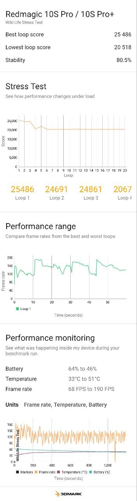
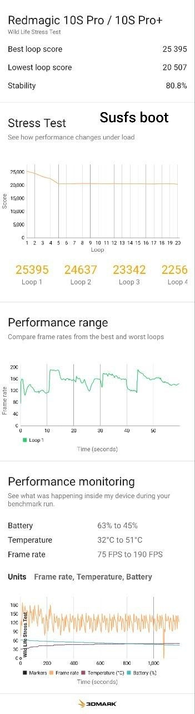

# RedMagic 10S Pro (NX789J) — stock-matched SukiSU Ultra kernel + SUSFS

A rebuild of the **exact stock GKI kernel** that ships on the RedMagic 10S Pro
(Android 16, firmware 11.0.11) with root support and SUSFS built in. Nothing else is changed.

**Kernel:** `6.6.92-android15-8-g3637f4904cf5` — Google GKI build 13944661, rebuilt from
Google's public source at the same commit, same toolchain (clang r510928), same config.

## Added
- SukiSU Ultra (built-in, manual hooks)
- SUSFS 2.3.0 (kernel side; the optional SUSFS module from [susfs4ksu](https://github.com/ShirkNeko/susfs4ksu) is not required for the kernel to work)
- KPM support

## Differences from stock (verified against the stock kernel)
| | stock | this |
|---|---|---|
| Config | — | only `MODULE_SIG_PROTECT` off (lets Google-signed `system_dlkm` modules load under a non-Google build key) and `FRAME_WARN` (compile-time warning threshold) |
| Module symbol CRCs | — | 0 mismatches, all stock vendor modules load unchanged |
| Modules loaded | 477 | 476 (one demand-loaded module differs by capture time) |
| CPU / GPU frequencies, governors, thermal zones | identical | identical |
| 3DMark Wild Life Stress (best / lowest / stability, peak temp) | 25 486 / 20 518 / 80.5 %, 51 °C | 25 395 / 20 507 / 80.8 %, 51 °C |

### 3DMark Wild Life Stress Test — stock boot vs this kernel
| Stock boot.img | boot-sukisu+susfs.img |
|---|---|
|  |  |

Same phone, same firmware, back to back: best loop 25 486 vs 25 395, lowest 20 518 vs 20 507, stability 80.5 % vs 80.8 %, peak 51 °C on both — within run-to-run noise.

## Download (`release/` folder — click the file, then **Download raw**)
| File | What |
|---|---|
| [`release/boot-sukisu+susfs.img`](release/boot-sukisu+susfs.img) | the kernel — full 96 MB boot image |
| [`release/SukiSU_v4.2.1_41023-release.apk`](release/SukiSU_v4.2.1_41023-release.apk) | SukiSU Ultra manager matching this kernel (UAPI 6) |

SHA-256 of each file is in `boot-sukisu+susfs.img.sha256`.

## Install
1. Unlocked bootloader. Firmware **11.0.11** only (other firmware ships a different stock kernel).
2. Back up your stock `boot.img`.
3. Flash `boot-sukisu+susfs.img` to **boot** on your active slot (EDL, or `fastboot flash boot_a boot-sukisu+susfs.img`).
   Keep the **stock `init_boot`** — this image replaces the whole boot partition; do not combine it with an LKM-patched init_boot.
4. Boot, install `SukiSU_v4.2.1_41023-release.apk`. It should show *Working* with SUSFS and KPM listed as supported.
5. Manager → SUSFS → Spoof uname → Release `6.6.92-android15-8-g3637f4904cf5-ab13944661-4k`, execution location **post-fs-data**.
   `uname -r` now reads exactly like stock.

**Rollback:** flash your stock `boot.img` back.

The image is a full 96 MB boot partition with a valid AVB hash footer. On this device `boot` is a
chained AVB partition, so a bare kernel image flashed over the stock partition reboots to the bootloader.

## Notes
- The RedMagic-specific drivers (fan, shoulder triggers, display, charging, RGB…) are nubia's binary
  modules in `vendor_boot` / `vendor_dlkm` and are untouched. This is only the Google GKI part, which is
  why it can be rebuilt and verified to match.
- Build steps: [KERNEL-RECIPE.md](KERNEL-RECIPE.md).

## Credits
- Built, verified and tested on device by **[HammadY2346](https://github.com/HammadY2346)** (stock-source sync, SukiSU/SUSFS/KPM integration, AVB repack, stock-parity checks)
- [SukiSU Ultra](https://github.com/SukiSU-Ultra/SukiSU-Ultra) · [SUSFS](https://gitlab.com/simonpunk/susfs4ksu) (simonpunk) and the
  [ShirkNeko/susfs4ksu](https://github.com/ShirkNeko/susfs4ksu) GKI branches · [SukiSU_patch](https://github.com/SukiSU-Ultra/SukiSU_patch) (KPM)
- [Android Common Kernel](https://android.googlesource.com/kernel/common/) — Google

Use at your own risk. Not responsible for bricked devices, lost data or banned game accounts.
